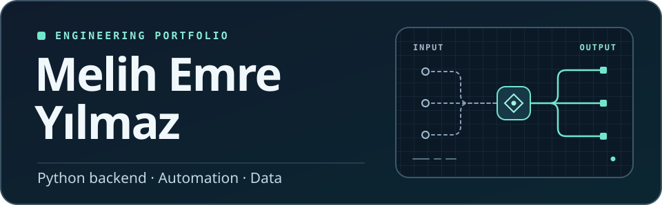

I build Python backends for web automation and data processing. I like working on problems where the inputs are messy and the decisions need to be easy to explain.

**[Projects](#selected-projects)** · **[Counterfake experience](#engineering-at-counterfake)**

## Selected projects

Generate and compare semester schedules for an industrial engineering curriculum using historical course offerings. **Streamlit · pandas · PySCIPOpt**

Explore primal, dual, and revised simplex and the Big-M method with runnable examples and tests. **Python · pytest**

Explore a sample financial workbook and forecast monthly revenue, expenses, or profit. **Streamlit · Prophet · Plotly**

## Engineering at Counterfake

At [Counterfake](https://counterfake.ai/brand-protection), I’ve worked on backend systems for online brand protection.

- **Web data collection.** I designed and built a service to automate data collection from websites, validate extracted records, and handle incomplete or failed extractions.
- **Seller matching.** I built an entity resolution service from the ground up, from normalizing inconsistent seller records to grouping likely duplicates.
- **Domain protection.** I helped extend the backend for evaluating suspicious domains, working on automated analysis, APIs, and monitoring.

These projects taught me to make failures visible, test how systems behave with incomplete inputs, and make automated decisions easier to investigate.
